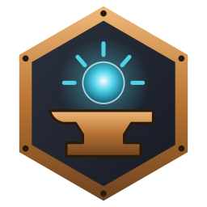

  

<h1 align="center">Arkeyan</h1>

<b>Native Skylanders on PC, macOS and Linux, built from your own disc.</b>

  
  
  
  
  

  <a href="https://github.com/mflr0/Arkeyan-Launcher/releases/latest"><b>Download the launcher</b></a> ·
  <a href="https://github.com/mflr0/Arkeyan-Launcher#the-games">The games</a> ·
  <a href="https://discord.gg/UMQY4SAS3F">Discord</a> ·
  <a href="https://github.com/mflr0/Arkeyan-Launcher/issues/new/choose">Report a bug</a>

---

The six Xbox 360 Skylanders games, from *Spyro's Adventure* to *Imaginators*, as real native programs: Direct3D 12 or
Vulkan on Windows, Metal on macOS, Vulkan on Linux, with higher resolutions, 60 FPS, a virtual Portal of Power and your
real one.

### How it works
1. **Your disc.** You give the launcher your own disc image. Nothing from the games is ever downloaded or shared.
2. **Translated on your computer.** The game's PowerPC code becomes C++ and its shaders become your system's shaders
   (static recompilation), then it is compiled into a native program.
3. **A runtime made for these games** replaces the Xbox 360: memory, threads, graphics, sound, controllers, saves and
   the Portal of Power.

### The repositories
| | |
|---|---|
| [**Arkeyan Launcher**](https://github.com/mflr0/Arkeyan-Launcher) | The app players install: it builds, starts and updates the games, and holds your figures |
| [**forge**](https://github.com/arkeyan-forge/forge) | Everything else: the runtime that replaces the Xbox 360, the builder that makes a game from your disc, each game's port, the tests and the docs. The code and shader translators are [hedge-dev](https://github.com/hedge-dev)'s, with our patches in `patches/` |

### Get involved
Bugs, ideas and questions go to the [launcher's issues](https://github.com/mflr0/Arkeyan-Launcher/issues/new/choose) (one place for every game). Pull requests:
read [CONTRIBUTING.md](https://github.com/mflr0/Arkeyan-Launcher/blob/main/CONTRIBUTING.md) first. Testers are welcome on the
[Discord](https://discord.gg/UMQY4SAS3F).

Designed by dorydev, made by mflr0, UI/UX by Gumelia. Built on XenonRecomp, XenosRecomp, plume, SDL and Dear ImGui.
Skylanders, Spyro and Activision are trademarks of Activision Publishing, Inc.; this project is not affiliated with or
endorsed by Activision. You need your own copy of the games.
